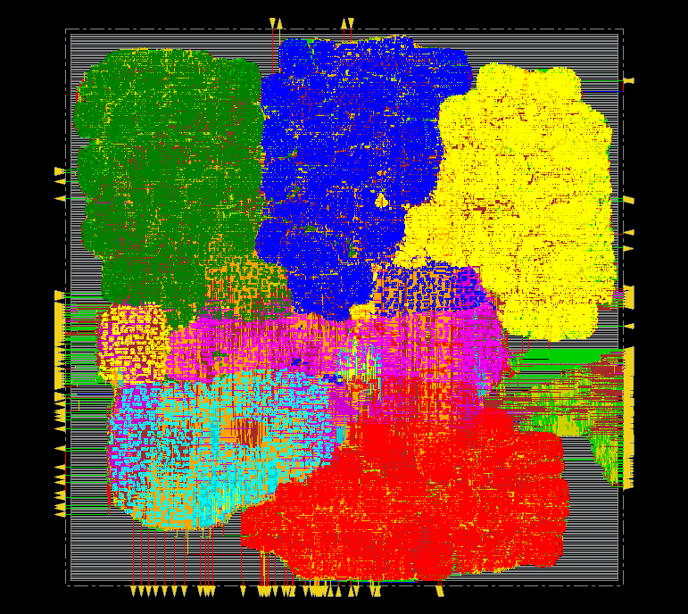

# Full-Scan DFT Flow for a Tensor-Core Streaming Multiprocessor (FreePDK45)

This project takes one streaming multiprocessor (SM) of a GPU-style tensor-core design all the way from RTL to tester patterns:
synthesis, scan insertion, equivalence checking, multi-mode place & route, ATPG, gate-level pattern simulation with SDF, STA cross-checks, STIL generation, failure diagnosis and an MBIST experiment.

ATPG uses the open-source Atalanta engine with a set of verification tools I built around it. A commercial ATPG tool would do some of this checking internally; here each step is checked independently: the ATPG model against the netlist, the patterns against an independent fault simulator, and the patterns against the post-route netlist through the scan chains.



*Post-route layout of one SM (925,020 µm²). The four large regions are the four tensor-core sub-partitions; the shared B memory sits in the middle (magenta) and the result memory at the lower left (cyan).*

---

## Design

| | |
|---|---|
| Full design (`rtl/vc707_top.v`) | 24 SMs (4 GPCs × 3 TPCs × 2 SMs), 96 tensor cores on a Xilinx VC707 FPGA |
| DFT / ASIC target (`rtl/sm_top.v`) | **one SM**: 4 sub-partitions × 1 tensor core × 16 MACs (16×16 → 48 bit) = 64 MACs, A/B/result memories, CDC logic |
| Clocks | `tile_clk` (SM clock) and `clk_mem` (host / memory side), **asynchronous** |
| Library | FreePDK45 / OSU `gscl45nm` (no scan flops, no SRAM) |
| Size | 20,707 flops (16,153 `tile_clk` + 4,554 `clk_mem`), memories as flops (`AW = 4`) |

**Why one SM.** The 24 SMs are identical, so the SM is the unit you would harden once and replicate (hierarchical DFT: one core-level ATPG run, patterns broadcast to all instances). The FPGA top also contains Xilinx clocking primitives (MMCM, BUFG) that cannot go through an ASIC flow.

## Flow

```
RTL ─► DC synthesis ─► scan insertion ─► LEC ─► Innovus P&R (func + shift modes) ─► LEC ─► chain test (SDF)
                                                       │
       ┌───────────────────────────────────────────────┘
       ▼
ATPG model + check ─► Atalanta ATPG (per clock) ─► independent coverage check ─► undetected-fault analysis
       ─► serial pattern simulation (zero-delay + SDF) ─► STIL ─► transition grading (LOC/LOS)
       ─► PrimeTime cross-check ─► diagnosis of injected defects                    (+ MBIST experiment)
```

| Step | Tool / script |
|---|---|
| Synthesis (2.2 ns constraint, `AW=4`) | Design Compiler, `scripts/01_syn.tcl` |
| Scan insertion: mux-D scan cells from `MUX2X1 + INVX1`, 16 single-domain chains | `scripts/scan_insert.py` |
| Equivalence: synthesized vs scan netlist, scan vs post-route | Conformal LEC |
| P&R with two constraint modes (functional, scan shift) on every step | Innovus, `scripts/04_pnr.tcl`, `04b_postroute_eco.tcl` |
| Netlist → combinational ATPG model (Liberty functions, constant folding), checked against the netlist | `scripts/netlist2bench.py`, `verify_bench.py` |
| ATPG, one-hot capture per clock domain | Atalanta + `scripts/atalanta_fixes.patch` |
| Independent fault simulation, union coverage | `scripts/coverage_union.py`, `check_coverage.py` |
| AU / UR / ND classification | `scripts/analyze_undetected.py` |
| Tester-style serial simulation through the scan chains | `scripts/gen_scan_tb.py` + Xcelium |
| STIL (IEEE 1450) with read-back check | `scripts/gen_stil.py` |
| Transition-fault grading, launch-on-capture and launch-on-shift | `scripts/transition_grade.py` |
| Second STA tool (SDF correlation, SPEF + original library) | PrimeTime, `scripts/07_pt.tcl` |
| Chain and logic diagnosis from fail logs | `scripts/diagnose.py` |
| March-test MBIST with redundancy analysis | `mbist/` |
| Everything after P&R, with a pass/fail check per step | `scripts/run_after_pnr.sh` |

## Results

| | |
|---|---|
| Scan chains | 16 (12 `tile_clk`, 4 `clk_mem`, no domain mixing → no lockup latches), longest 1,347 |
| LEC (pre-scan vs scan, scan vs post-route) | both equivalent, 0 non-equivalent (20,919 / 20,935 compare points) |
| Functional timing (sign-off) | **385 MHz** `tile_clk` / 200 MHz `clk_mem`: setup +0.062 ns, hold +0.017 ns, 0 violations (target was 400 MHz; see below) |
| Shift-mode timing | setup +6.68 ns, hold met (100 MHz shift) |
| Area / power | 640,896 µm² standard cells (925,020 µm² die), 591.7 mW |
| Patterns | 2,056 (1,653 `tile_clk` + 403 `clk_mem`, one-hot capture) |
| **Stuck-at coverage** | **99.924 % fault coverage, 99.983 % test coverage** (595,100 collapsed faults; UR 348, AU 0, aborted 104) |
| Independent check | 29.0 M expected bits reproduced, 0 differ; sampled coverage 99.97 % (95 % CI 99.93–99.99) |
| Serial simulation | **all 2,056 patterns pass** through the scan chains on the post-route netlist (42.6 M scan-out bits); first 40 patterns per clock also pass with post-route SDF, 0 timing violations |
| Transition faults (graded) | LOC 93.97 %, LOS 96.45 %, LOC ∪ LOS 98.29 % (20,000 sampled faults; algorithm cross-checked against brute-force simulation, 480/480 agree) |
| STIL | 2,056 patterns; read back and compared with the simulated data, 89.4 M bits, 0 differ |
| Test time | ≈ 2.77 M tester cycles (27.7 ms at a 100 MHz shift clock) |
| Diagnosis | injected logic defect: unique perfect match out of 3,468 candidates; injected chain break: exact flop out of 601 candidate positions |
| MBIST (512×32 SRAM model) | March C- with 6 data backgrounds detects 100 % of 1,150 injected faults; repair verified |

Raw reports and logs are in [`results/`](results/).

## Findings worth reading

**1. Innovus signed off 0.67 ns too optimistically.**
PrimeTime, reading the SDF that Innovus itself wrote, found −0.255 ns on 49 endpoints, while Innovus reported +0.414 ns. The cause: CCOpt's default `update_io_latency` inserted `set_clock_latency -source` after CTS, which Innovus applied only on the launch side of a high-fanout clear path. With `set_ccopt_property update_io_latency false` and a P&R rerun the two tools agree on the same critical path (remaining 0.09 ns difference: Innovus' OCV treats early and late clock paths separately, the SDF has one value; sign-off uses the worse number).

**2. False violations from spikes in the Liberty constraint tables.**
Post-CTS setup went from +0.004 to −0.339 ns (214 paths) with every worst path showing a library setup time above 1 ns on a 2.5 ns clock. A few entries of the DFF setup and DFFSR recovery tables are 1.8–6.2 ns among 0.03–0.6 ns neighbours. `scripts/fix_lib.py` replaces them conservatively (with the largest regular value of the same table) in a P&R-only copy of the library. PrimeTime with the original library and SPEF reproduces the effect independently (−1.15 ns, library setup 1.52–1.69 ns on the worst paths).

**3. Capturing two asynchronous clocks in the same cycle races.**
With both clocks pulsed in every capture, all patterns passed at zero delay but pattern 39 failed 42 bits with SDF: cross-domain paths resolved in clock-tree order. The flow now builds one ATPG model and pattern set per clock domain (only that clock is pulsed, the other domain must hold its loaded value), and grades the union on one common fault list.

**4. Post-route restructuring made logic redundant.**
346 of the 348 redundant faults are on cells Innovus created during optimization (`FE_RC_*`, all in the MAC adders); the pre-layout netlist has 2. One example: Innovus built `OR(a·b, a+b)`, which is just `a+b`, so a stuck-at-0 on the `a·b` input can never be observed. LEC passes because the function is unchanged, but fault coverage drops from 99.982 % to 99.924 %. Releasing `scan_en` and the resets in targeted ATPG makes none of them testable (AU = 0, all UR).

**5. Scan-path hold dominates hold fixing.**
78 % of the 41,287 hold buffers sit between the scan mux and the flop D pin: on a scan path Q drives the next scan input with no logic in between, so clock skew alone causes hold violations. Placed after the mux, these buffers also slow the functional path.

**6. Timing closure.**
The MAC multiplier / 48-bit accumulator missed 400 MHz by 129 ps after routing; the post-route setup optimization had reached −67 ps before a separate hold-fix pass gave part of it back. Three rounds of combined setup + hold optimization (hold fixing not allowed to degrade setup, then high effort with useful skew) reached −38 ps on 5 paths; the design is signed off at 2.6 ns (385 MHz). Re-synthesizing with a tighter period would let DC choose a faster adder architecture.

**7. The open-source ATPG engine had silent bugs.**
Atalanta had the random-pattern phase commented out, an unchecked 32,000-pattern buffer, and a hard-coded `iNoPI = 3357` in compaction that silently corrupts patterns of circuits with more inputs. `scripts/atalanta_fixes.patch` fixes all three; on the bundled s13207 benchmark coverage, redundant and aborted counts are unchanged and the pattern count drops from 1,186 to 482.

**8. Other pitfalls.**
Innovus writes SDF as `(min::max)` with an empty typical value; Xcelium reads typical by default, so the simulation silently runs at zero delay unless `-maxdelays` is given (checked by requiring 100 % annotation). After changing an SDC and re-running only sign-off, `update_constraint_mode` reloads ideal clocks; the first re-sign-off number was an ideal-clock result.

## Diagnosis experiment

`scripts/diagnose.py` uses only what a test floor has: the applied patterns, the fail log, and the netlist.

- **Logic**: a stuck-at-1 injected on an internal multiplier net produced 27 failing bits in 100 patterns. Candidates are the intersection of the fan-in cones of the failing observation points (1,735 nets, 3,468 faults); each is fault-simulated against the fail log. The injected fault is the only perfect match (TFSF 27, TFSP 0, TPSF 0); the next candidates are internal nodes of the same cell.
- **Chain**: Q of the flop at position 600 of chain 3 stuck-at-0. From the unload data alone: chain 3, stuck-at-0, position ≤ 600. Simulating "flop *c* stuck" for every candidate gives 0 miscompares at position 600 and 3, 8, 12, … for its neighbours.

## MBIST experiment

The A memory of the SM is a 512×32 RAM in the FPGA build; in silicon it would be an SRAM macro tested by MBIST. `mbist/` contains a synchronous SRAM model with fault injection (SAF, TF, CFin, CFid, CFst inter- and intra-word, address-decoder faults) and two spare words, and a synthesizable controller (MATS+, March X, March C-; solid or log2(32)+1 data backgrounds; built-in redundancy analysis).

| Fault class (50 each) | MATS+ (solid) | March X (solid) | March C- (solid) | March C- (6 backgrounds) |
|---|---|---|---|---|
| SAF, AF | 100 % | 100 % | 100 % | 100 % |
| TF ↓ | 0 % | 100 % | 100 % | 100 % |
| CFid ↓;1 (inter-word) | 0 % | 60 % | 100 % | 100 % |
| CFid ↑;1 (intra-word) | 0 % | 0 % | **0 %** | **100 %** |
| all 1,150 faults | 65.1 % | 79.0 % | 91.3 % | 100 % |

All results match March-test theory. Single-fault cases are repaired with the spare words and pass March C- afterwards; three failing words (more than the spares) are reported as not repairable. Controller: 4,464 µm², 197 flops, meets 400 MHz with 0.66 ns slack. Full table: [`results/mbist/mbist_results.txt`](results/mbist/mbist_results.txt).

## What is not done

- No OCC / at-speed capture; transition faults are graded, not targeted by ATPG.
- No scan compression, boundary scan / JTAG, or IEEE 1687/1500 networks.
- Asynchronous resets are held inactive during capture, so reset logic is not covered by ATPG.
- Single typical corner, no signal-integrity analysis.
- SDF pattern simulation covers the first 40 patterns of each clock (all patterns at zero delay).
- The STIL output is checked for consistency with the simulated data, not by a tester or STIL reader.
- `scripts/06_atpg_tmax.tcl` and `06_atpg_modus.tcl` were written for commercial ATPG tools but never run (no license).

## Running it

Tools: Design Compiler, Innovus 25.1, Conformal LEC, Xcelium, PrimeTime, Python 3, Atalanta (`https://github.com/hsluoyz/Atalanta` + `scripts/atalanta_fixes.patch`), and the FreePDK45 OSU standard-cell library (not included). Paths to the PDK and the site setup scripts (`~/setup_*.csh`) at the top of the scripts need to be adapted.

```
dc_shell -f scripts/01_syn.tcl
python3 scripts/scan_insert.py --netlist netlist/sm_top_syn.v --lib $PDK/gscl45nm.lib --top sm_top --chains 16 \
    --out netlist/sm_top_scan.v --outdir scan --hold rst_n_mem=1 --hold tile_rst_req=0
lec -nogui -xl -dofile scan/lec_scan.do
innovus -no_gui -files scripts/04_pnr.tcl            # then 04b_postroute_eco.tcl / 04c_resignoff.tcl if needed
bash scripts/run_after_pnr.sh                         # LEC, ATPG, checks, simulation, STIL, grading, PrimeTime, diagnosis
cd mbist && python3 run_mbist.py --per-class 50
```

Every script starts with a description of what it does and how it was verified.
